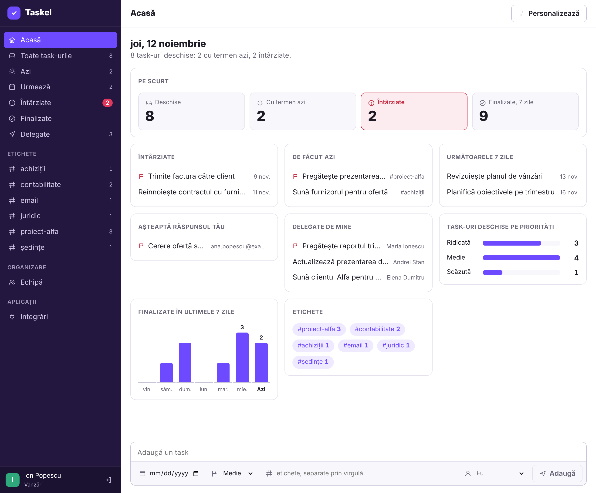
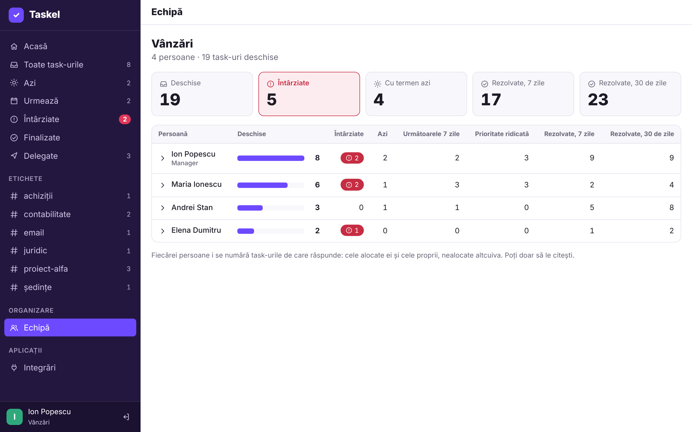
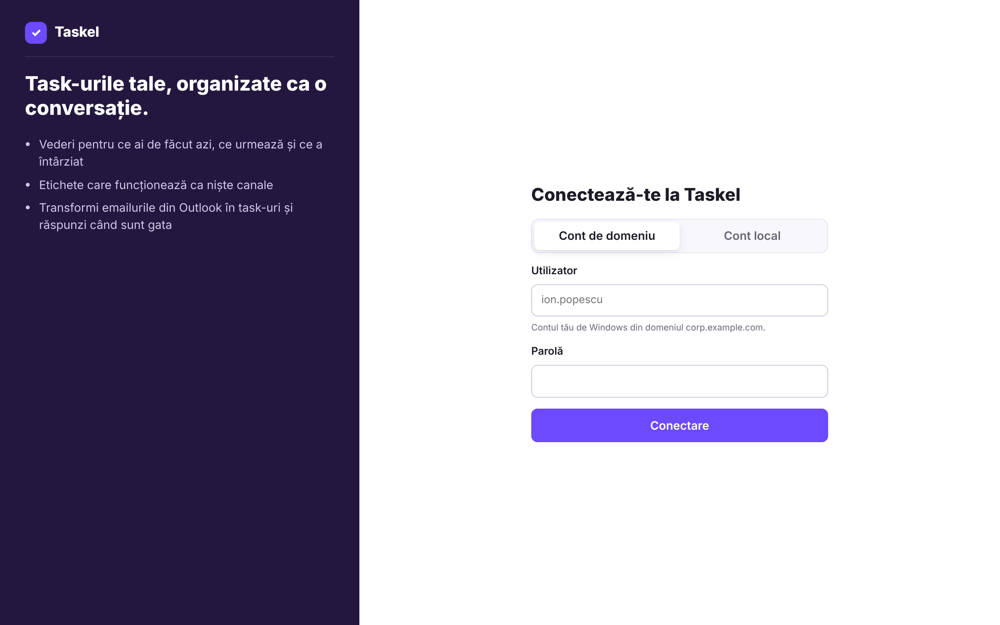
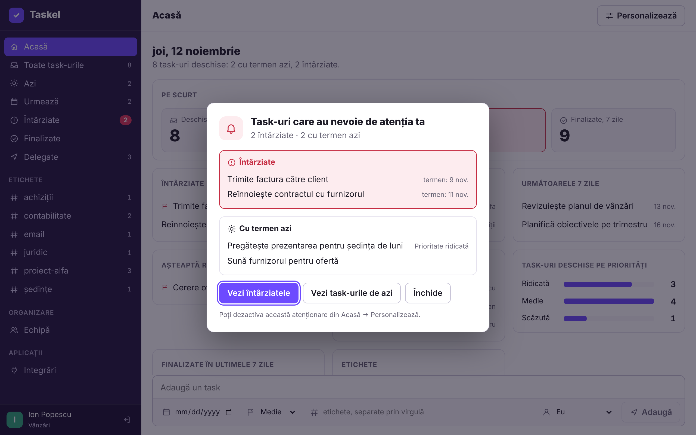
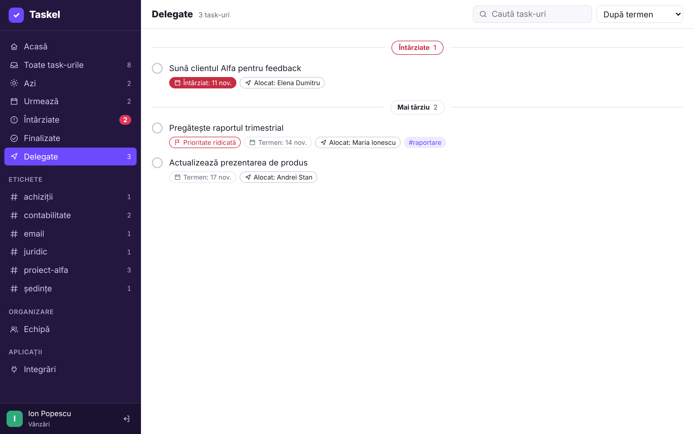
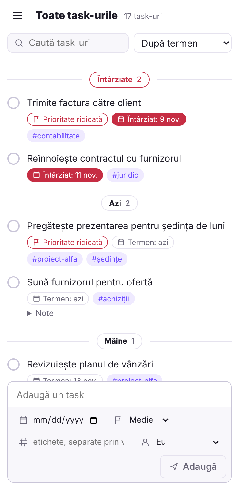

# Taskel

Task management app with an **ASP.NET Core (.NET 10)** backend and a **React + Vite + TypeScript** frontend (Node.js).
The interface is in Romanian; code, API and documentation are in English.




## Screenshots

| | |
|---|---|
| **Team workload** for managers: each person in the department<br> | **A team member's tasks**, in full, read only<br> |
| **Sign in** with a domain or a local account<br> | **Roles and departments**, for administrators<br> |
| **Reminder on opening the app**, when tasks are overdue or due today<br> | **Task list**, grouped by due date, with tags as channels<br> |
| **Delegated tasks**: what you assigned to others<br> | **Reply on completion** for tasks created from emails<br> |
| **Customizable dashboard**: add, remove and reorder widgets<br> | **Dark theme**<br> |
| | **Mobile**<br>  |

Screenshots use sample data: made-up people and tasks in a test domain.

## Project layout

```
Taskel/
├── backend/                     # ASP.NET Core Web API (.NET 10)
│   ├── Taskel.slnx
│   ├── src/Taskel.Api/          # API: controllers, models, services
│   └── tests/Taskel.Api.Tests/  # xUnit integration tests
├── frontend/                    # React + Vite + TypeScript
├── integrations/outlook/        # Outlook macro: turn emails into tasks
└── .github/workflows/ci.yml     # Build + test both projects
```

## Prerequisites

- [.NET 10 SDK](https://dotnet.microsoft.com/download/dotnet/10.0)
- [Node.js](https://nodejs.org/) 22+
- PostgreSQL 16+ — easiest via Docker: `docker compose up -d` (uses `docker-compose.yml`)

## Running locally

**Database**:

```bash
docker compose up -d          # PostgreSQL on localhost:5432 (user/password/db: taskel)
```

**Backend** (http://localhost:5000):

```bash
cd backend
dotnet run --project src/Taskel.Api
```

In Development the API applies EF Core migrations automatically on startup.

**Frontend** (http://localhost:5173) — in a second terminal:

```bash
cd frontend
npm install
npm run dev
```

The Vite dev server proxies `/api/*` to the backend, so no CORS setup is needed in development.
For other setups, see `frontend/.env.example` and `Cors:AllowedOrigins` in `backend/src/Taskel.Api/appsettings.json`.

## API

| Method | Route                | Auth | Description                                   |
|--------|----------------------|------|-----------------------------------------------|
| GET    | `/api/health`        | –    | Health check                                  |
| POST   | `/api/auth/register` | –    | Create an account and sign in                 |
| GET    | `/api/auth/options`  | –    | What the sign-in screen should offer          |
| POST   | `/api/auth/login`    | –    | Sign in with a local account                  |
| POST   | `/api/auth/login/directory` | – | Sign in with an Active Directory account   |
| POST   | `/api/auth/logout`   | –    | Sign out                                      |
| GET    | `/api/auth/me`       | ✓    | Current user                                  |
| GET    | `/api/auth/tokens`   | session | List your API tokens                       |
| POST   | `/api/auth/tokens`   | session | Create an API token (shown once)           |
| DELETE | `/api/auth/tokens/{id}` | session | Revoke an API token                     |
| GET    | `/api/dashboard`     | ✓    | Your dashboard preferences                    |
| PUT    | `/api/dashboard`     | ✓    | Save your dashboard preferences               |
| GET    | `/api/users`         | ✓    | People a task can be assigned to              |
| GET    | `/api/team`          | manager | Workload of the people in a department     |
| GET    | `/api/team/members/{id}/tasks` | manager | A team member's tasks, read only |
| GET    | `/api/admin/users`   | admin | Accounts with their role and department      |
| PUT    | `/api/admin/users/{id}` | admin | Set an account's role and department      |
| GET    | `/api/tasks`         | ✓    | List tasks you created or were assigned       |
| GET    | `/api/tasks/{id}`    | ✓    | Get a task                                    |
| POST   | `/api/tasks`         | ✓    | Create a task                                 |
| POST   | `/api/tasks/from-email` | ✓ | Create a task from an email                   |
| PUT    | `/api/tasks/{id}`    | ✓    | Update a task                                 |
| PUT    | `/api/tasks/{id}/assignee` | ✓ | Assign a task (creator only)                |
| POST   | `/api/tasks/{id}/complete` | ✓ | Complete a task, with a response (required for email tasks) |
| DELETE | `/api/tasks/{id}`    | ✓    | Delete a task                                 |

✓ = browser session or API token. "session" = browser session only.

### Task fields

| Field         | Type                          | Notes                                                              |
|---------------|-------------------------------|--------------------------------------------------------------------|
| `title`       | string, 1–200 chars           | Required                                                           |
| `description` | string, up to 2000 chars      | Optional                                                           |
| `isCompleted` | boolean                       | Set through `PUT`                                                  |
| `dueDate`     | `"YYYY-MM-DD"` or `null`      | A calendar date, no time or time zone                              |
| `priority`    | `"low"`, `"medium"`, `"high"` | Defaults to `"medium"`                                             |
| `tags`        | array of strings              | Up to 10 tags of up to 30 chars; trimmed, lower-cased, de-duplicated |
| `sourceEmailAddress` | string or `null`       | Read-only. Sender of the email the task came from                  |
| `completionResponse` | string or `null`       | Read-only. The response given when the task was completed          |
| `completedAt` | timestamp or `null`           | Read-only                                                          |
| `createdBy`   | `{ id, email, displayName }`  | Read-only. Who created the task                                    |
| `assignee`    | same shape, or `null`         | Read-only here; set with `assigneeId` on create or through `/assignee` |

`PUT` replaces the whole task: omitted optional fields are reset (no due date, medium priority, no tags).

The OpenAPI document is available at `/openapi/v1.json` in Development.

## Authentication

- Accounts are email + password. Passwords (8+ characters) are stored hashed with ASP.NET Core's `PasswordHasher` (PBKDF2).
- Sessions use an **HttpOnly cookie** (`taskel.auth`, `SameSite=Lax`, 14 days, sliding), so JavaScript never sees a token.
  Outside Development the cookie is `Secure` and is only sent over HTTPS.
- Every task belongs to the user who created it; users only see and change their own tasks.
- Unauthenticated requests to protected endpoints get `401`.
- Deployment notes:
  - Serve the frontend and the API from the same site (as the Vite dev proxy does). A frontend on a different site
    needs `SameSite=None` on the cookie plus its origin in `Cors:AllowedOrigins`.
  - The cookie is encrypted with ASP.NET Core Data Protection keys. Persist them (e.g. a mounted volume) when running
    in containers or on several instances, otherwise users are signed out on every restart.
  - There is no rate limiting on login/register yet.

### API tokens

Clients that cannot use the browser session send a personal API token instead:

```
Authorization: Bearer tsk_…
```

- Create and revoke tokens in the app under **Integrări** (Integrations; up to 10 per user). A token is shown once;
  only its SHA-256 hash is stored.
- A token gives access to its owner's tasks. It cannot list, create or revoke tokens.

## Outlook integration

`integrations/outlook` contains a VBA macro for classic Outlook on Windows that sends the selected emails to
`POST /api/tasks/from-email`; each becomes a task tagged `email`, with the subject as title and the sender,
date and body as notes. See [integrations/outlook/README.md](integrations/outlook/README.md) for setup.

## Input validation

Every request is validated before anything is stored:

- **Shape.** Bodies must be JSON objects of at most 1 MB. Unknown properties are rejected (`400`), so a
  misspelt field is an error rather than silently ignored. Enums are strings; ids are GUIDs.
- **Text.** Titles, notes, tags, token names, responses and user names reject control characters, NUL and
  unpaired UTF-16 surrogates. Notes and responses may contain line breaks and tabs; single-line fields may not.
  Text is trimmed, and blank notes are stored as none.
- **Limits.** Title 1–200 characters, notes 2000, completion response 4000, up to 10 tags of up to 30 characters
  (no commas), due dates between 2000-01-01 and 2100-12-31, passwords 8–128 characters.
- **Email addresses** must be plain `name@host.tld` addresses.
- **Emails turned into tasks** are the exception: they come from outside, so their text is cleaned (unsafe
  characters removed, long values shortened) instead of rejected. Only the overall shape and lengths are checked.

The interface applies the same rules in its forms and shows the reason in Romanian. Validation failures return
`400` with a problem-details body listing the fields.

## Assigning tasks

A task belongs to the user who created it and can be assigned to one other user.

- Assign on create with `assigneeId`, or later with `PUT /api/tasks/{id}/assignee` and
  `{ "assigneeId": "…" }` (`null` takes the task back). `GET /api/users` lists the people to choose from.
- The creator and the assignee both see the task, edit it and complete it (with the emailed reply, for
  tasks from emails). Only the creator can delete or reassign it; the assignee gets `403`.
- Other users cannot see the task at all (`404`).
- In the interface, your own work (assigned to you, or yours and unassigned) fills the usual views, the
  dashboard and the reminder; what you handed to others is under **Delegate**.

`GET /api/users` shows every account's name and email to every signed-in user, which suits a team
installation. The assignee picker is a plain list, so it is meant for tens of users rather than thousands.

## Roles, departments and team workload

Every account has a **role** and, optionally, a **department**.

| Role      | Can do, on top of the role before it                                                    |
|-----------|-----------------------------------------------------------------------------------------|
| `user`    | Work with their own tasks and the tasks assigned to them                                |
| `manager` | Open **Echipă** (Team): the workload of the people who share their department           |
| `admin`   | Open **Utilizatori** (Users) to set roles and departments, and look at any department   |

**Team workload** (`GET /api/team`) lists each person in the department with their open tasks, overdue tasks,
tasks due today and in the next 7 days, open high-priority tasks, and tasks completed in the last 7 and 30 days,
plus department totals. A person is counted for the tasks they are responsible for: those assigned to them, and
their own that they have not handed to someone else. Pass `today=YYYY-MM-DD` so "overdue" follows the viewer's
date; a value more than a day away from the server's is ignored.

`GET /api/team/members/{id}/tasks` returns a member's tasks in full, notes and replies included, for reading.
It does not give the manager access to the tasks themselves: they cannot edit, complete or delete them.

A manager can only name their own department (`403` otherwise) and a manager without a department sees nobody.
Roles and departments are read from the database on every request, so a change applies at once, without
signing in again.

Where roles and departments come from:

- **Administrators** set them in the interface (`PUT /api/admin/users/{id}`). An administrator cannot change
  their own role.
- **The first administrator** is named in configuration: `Auth__AdminEmails__0=you@example.com` (more with
  `__1`, `__2`, …). Those accounts are always administrators.
- **Active Directory**, for domain accounts, at every sign-in: the department is read from the `department`
  attribute (when the user has one), and members of `ManagerGroupDn` / `AdminGroupDn` become managers /
  administrators. A configured group also takes the role away from people who are not in it. What the directory
  does not speak for is left as set in Taskel.

## Active Directory sign-in

Users can sign in with their domain account. Taskel checks the password by binding to Active Directory over
LDAP as that user, so no service account is needed. Local (email + password) accounts keep working.

| Setting           | Environment variable                 | Notes                                                    |
|-------------------|--------------------------------------|----------------------------------------------------------|
| `Enabled`         | `ActiveDirectory__Enabled`           | `true` to turn it on                                     |
| `Host`            | `ActiveDirectory__Host`              | A domain controller, e.g. `dc1.corp.example.com`         |
| `Port`            | `ActiveDirectory__Port`              | `636` (default)                                          |
| `Security`        | `ActiveDirectory__Security`          | `Ldaps` (default), `StartTls` (port 389) or `None`       |
| `Domain`          | `ActiveDirectory__Domain`            | DNS name of the domain, e.g. `corp.example.com`          |
| `BaseDn`          | `ActiveDirectory__BaseDn`            | Where users live, e.g. `DC=corp,DC=example,DC=com`       |
| `RequiredGroupDn` | `ActiveDirectory__RequiredGroupDn`   | Optional. Only direct members of this group may sign in  |
| `DepartmentAttribute` | `ActiveDirectory__DepartmentAttribute` | Default `department`                               |
| `ManagerGroupDn`  | `ActiveDirectory__ManagerGroupDn`    | Optional. Direct members are managers in Taskel          |
| `AdminGroupDn`    | `ActiveDirectory__AdminGroupDn`      | Optional. Direct members are administrators in Taskel    |
| `TimeoutSeconds`  | `ActiveDirectory__TimeoutSeconds`    | Default 10                                               |

Related settings in the `Auth` section: `Auth__AllowLocalRegistration` (`false` stops new local accounts) and
`Auth__LoginAttemptsPerMinute` (default 10 per client address; further attempts get `429`).

How it behaves:

- Users type `ion.popescu`, `CORP\ion.popescu` or `ion.popescu@corp.example.com`.
- The first sign-in creates the Taskel account from the directory entry: email (`mail`, falling back to the
  logon address), display name, and `objectGUID`, which links the account from then on. Later sign-ins follow
  changes of name or email.
- A local account with the same email is taken over by the directory account: it keeps its tasks and its local
  password stops working. Directory accounts cannot sign in with the local form.
- Disabled or locked accounts, wrong passwords and empty passwords are refused (`401`). If the directory
  cannot be reached the answer is `503`.

Things to know:

- **TLS.** The domain controller's certificate must be trusted by the machine running Taskel and must match
  `Host`. Use `None` only in a lab: it sends passwords in clear text.
- **Lockout.** Failed sign-ins count against the account in Active Directory. The rate limit is per client
  address; behind a reverse proxy configure forwarded headers, or every user shares one address.
- **Groups.** `RequiredGroupDn`, `ManagerGroupDn` and `AdminGroupDn` check direct membership (`memberOf`), not
  nested groups.
- **Leaving.** An account removed from the directory can no longer sign in, but an open session lasts until
  its cookie expires, and its Taskel account and tasks remain.

`RealDirectoryTests` run the LDAP code against a real directory when `TASKEL_TEST_AD_HOST` is set (see the
class comment for the accounts it expects); they were developed against a Samba AD domain controller and are
skipped otherwise, including in CI.

## Dashboard and reminders

The app opens on **Acasă** (Home), a dashboard built from widgets: at-a-glance counts, overdue, due today, next 7 days,
email tasks waiting for a reply, tasks delegated to others, open tasks by priority, tasks completed over the last 7 days, tags, and recently
completed.

- **Personalizează** (Customize, top right) lets each user remove, add and reorder widgets, or reset to the default layout.
  Changes are saved to the user's account as they are made (`PUT /api/dashboard`), so they follow the user
  across browsers.
- When the app is opened and there are tasks that are overdue or due today, a reminder dialog lists them, with
  shortcuts to the overdue and today views. It is shown once per visit and can be turned off under Personalizează.
- Preferences are `{ "widgets": ["stats", "overdue", …] | null, "showDueAlert": true }`. `null` means the default
  layout. Widget ids are defined by the frontend (`frontend/src/lib/dashboard.ts`); the API only checks their shape.
- "Completed, last 7 days" counts by completion time, which is recorded since the completion-reply feature; tasks
  completed before that are not counted.

## Completing email tasks with a reply

A task created from an email remembers who sent that email. Such a task can only be completed by writing a
response:

- `POST /api/tasks/{id}/complete` with `{ "response": "…" }` (up to 4000 characters). In the app, ticking the
  task opens the response form.
- Taskel emails the response to the sender as a reply to the original email (`Re:` subject, `In-Reply-To` and
  `References` headers), so it shows up in the same conversation.
- The task is marked as completed only after the SMTP server has accepted the reply. If sending fails
  (`502`) or email is not configured (`503`), the task stays open.
- Setting `isCompleted: true` through `PUT` is rejected for these tasks. Reopening through `PUT` is allowed;
  completing again needs a new response and sends a new reply.
- Tasks added by hand, and email tasks without a usable sender address, complete without a response.

### Email (SMTP) configuration

Replies are sent from one mailbox, configured on the server in the `Email:Smtp` section:

| Setting       | Environment variable         | Notes                                                    |
|---------------|------------------------------|----------------------------------------------------------|
| `Host`        | `Email__Smtp__Host`          | e.g. `smtp.gmail.com`                                    |
| `Port`        | `Email__Smtp__Port`          | `587` (STARTTLS, default) or `465` (TLS)                 |
| `Username`    | `Email__Smtp__Username`      | Usually the full email address                           |
| `Password`    | `Email__Smtp__Password`      | For Gmail, an [app password](https://support.google.com/accounts/answer/185833), not the account password |
| `FromAddress` | `Email__Smtp__FromAddress`   | Optional; defaults to `Username`                         |
| `FromName`    | `Email__Smtp__FromName`      | Optional display name                                    |

Keep the password out of `appsettings.json`. For local development use user secrets:

```bash
cd backend/src/Taskel.Api
dotnet user-secrets init
dotnet user-secrets set "Email:Smtp:Host" "smtp.gmail.com"
dotnet user-secrets set "Email:Smtp:Username" "you@gmail.com"
dotnet user-secrets set "Email:Smtp:Password" "your-app-password"
```

Things to know:

- All users' replies are sent from this one mailbox. A recipient who answers the reply writes to that mailbox.
- Sent replies are not saved to a "Sent" folder by Taskel (Gmail keeps its own copy of mail sent through its SMTP server).
- Any signed-in user can make the server send one email per completed email task, to the address stored on that
  task. Do not expose a server with open registration and SMTP configured to the internet.

## Database (EF Core + PostgreSQL)

- `TaskelDbContext` lives in `backend/src/Taskel.Api/Data/`, migrations in `Data/Migrations/`.
- Connection string: `ConnectionStrings:Taskel` (Development value in `appsettings.Development.json`).
  In other environments set it via the `ConnectionStrings__Taskel` environment variable.
- Migrations run on startup in Development. Elsewhere set `Database__MigrateOnStartup=true`, or apply them explicitly:

```bash
cd backend
dotnet tool restore
dotnet ef migrations add <Name> -p src/Taskel.Api -o Data/Migrations   # after changing the model
dotnet ef database update -p src/Taskel.Api                             # apply to the database
```

## Tests

Backend tests run against a real PostgreSQL database `taskel_test` (recreated on each run).
Override with the `TASKEL_TEST_CONNECTION` environment variable.

```bash
cd backend && dotnet test
cd frontend && npm run lint && npm run build
```
